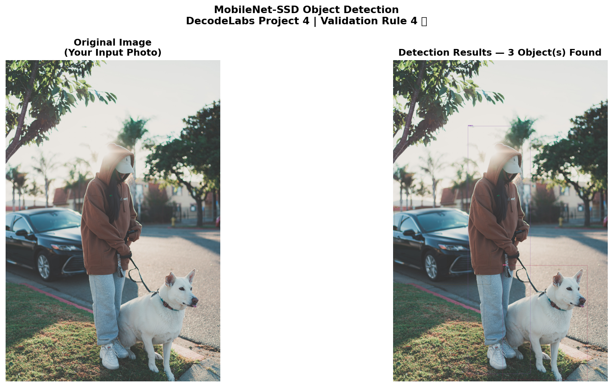

# OCR and Object Detection

Two computer vision scripts built with OpenCV: text extraction from images with Tesseract OCR, and object detection with a **pre-trained** MobileNet-SSD model. Built for the DecodeLabs AI Industrial Training (Batch 2026), Project 4.



## What It Does

**Path 1: OCR (`ocr_reader.py`)**
- Pre-processing: grayscale, Gaussian blur, adaptive threshold
- Text extraction with Tesseract (`pytesseract`), with confidence scores
- Saves the pre-processing pipeline and result as images

**Path 2: Object detection (`object_detector.py`)**
- Loads MobileNet-SSD (Caffe model) through the OpenCV DNN module
- Detects the 20 PASCAL VOC classes and draws labeled bounding boxes
- Filters weak predictions with a confidence threshold and non-maximum suppression

**Validation (`validation_report.py`)** runs checks on both paths and saves a report image.

This project applies a pre-trained model. It does not train a new one.

## Setup

1. Install Python 3.7 or newer.
2. Install the Tesseract OCR engine ([Windows installer](https://github.com/UB-Mannheim/tesseract/wiki)). The scripts look for it at `C:\Program Files\Tesseract-OCR\tesseract.exe`. If yours is installed elsewhere, edit the path near the top of the script.
3. Download the model file `MobileNetSSD_deploy.caffemodel` (about 23 MB) into the `models/` folder. See [`models/DOWNLOAD_MODELS.md`](models/DOWNLOAD_MODELS.md) for links. It is not stored in this repository because of its size.
4.Test images are for demonstration only. Replace them with your own images if you reuse this project

## Run

```bash
git clone https://github.com/ash-1212/ocr-object-detection.git
cd ocr-object-detection
pip install -r requirements.txt

python ocr_reader.py
python object_detector.py
python validation_report.py
```

## Project Structure

```
ocr-object-detection/
├── ocr_reader.py
├── object_detector.py
├── validation_report.py
├── images/                  # test images
├── models/                  # prototxt included, caffemodel downloaded separately
├── outputs/                 # generated result images
├── requirements.txt
└── README.md
```

## Pipelines

```
OCR:        Image → Grayscale → Gaussian blur (5x5) → Adaptive threshold → Tesseract → Text + confidence
Detection:  Image → Resize 300x300 → Blob → Forward pass → NMS → Bounding boxes + labels
```

## Detectable Classes

aeroplane, bicycle, bird, boat, bottle, bus, car, cat, chair, cow, diningtable, dog, horse, motorbike, person, pottedplant, sheep, sofa, train, tvmonitor

## Concepts Practiced

- Image pre-processing for OCR
- Using pre-trained models (transfer of existing weights, no training)
- OpenCV DNN module and blob creation
- Confidence thresholds and non-maximum suppression
- Bounding-box visualization

## Author

**Ayesha Nazish**
DecodeLabs AI Industrial Training, Batch 2026.
[GitHub](https://github.com/ash-1212) · [LinkedIn](https://www.linkedin.com/in/ayeshanazish-452048274)